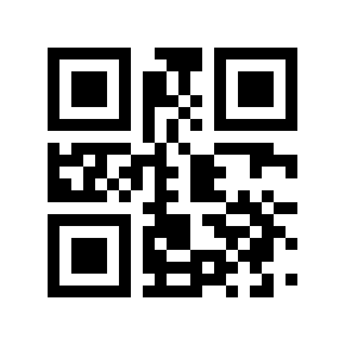

# QR Code decoder

## Files

```
bsv/
  QRDecoder.bsv    your design: replace the placeholder with your decoder
  QRTypes.bsv      the interfaces and the output type        do not modify
  QRTables.bsv     lookup tables for all 40 versions          do not modify
  TbSample.bsv     an example test bench: decodes one symbol and prints it
sample_qr.png      the symbol in TbSample.bsv as an image
```

We compile your code against our own copies of `QRTypes.bsv` and
`QRTables.bsv`, so changes you make to them are lost.

`QRTables.bsv` gives you, for every version and level, the block structure
(`blockParams`), the alignment pattern centres (`alignParams`), the 32 valid
format values (`formatCodeword`), powers of alpha in GF(2^8) (`alphaPow`,
j = 0..29, and `alphaInvPow`, j = 0..15), the GF(2^8) inverse (`gfInv`) and
the alphanumeric character set (`alnumChar`). Using it is optional.

## The example test bench

`TbSample.bsv` shows how our test bench drives your decoder:

1. it calls `start(size)` with the side length of the symbol;
2. it serves your memory reads: a `(row, col)` taken from `mem.req` in one
   cycle is answered through `mem.resp` in the next;
3. it collects the message through `getByte` until the byte with `last`
   set, or stops when `failed` (or, for an empty message, `done`) rises.

The symbol is written into the file as rows of 1s and 0s, top row first,
1 = dark: a version-1 (21x21) code, level M, mask 2, holding the
alphanumeric message `HELLO CAD FOR VLSI`. `sample_qr.png` shows the same
symbol as an image, with the usual white border. To try another symbol,
replace the rows (and `N` for another version).



To build and run it, from the `bsv/` folder:

```
mkdir -p build
bsc -u -sim -bdir build -simdir build -info-dir build -g mkTbSample TbSample.bsv
bsc -sim -e mkTbSample -bdir build -simdir build -o build/tbSample
./build/tbSample
```

## Submitting

See the project document for the folder layout of your zip. Before you
upload, take a fresh copy of this handout, copy the `bsv/` folder from your
zip over its `bsv/`, and check that it builds and runs there. That checks
that what you upload is what you tested.
